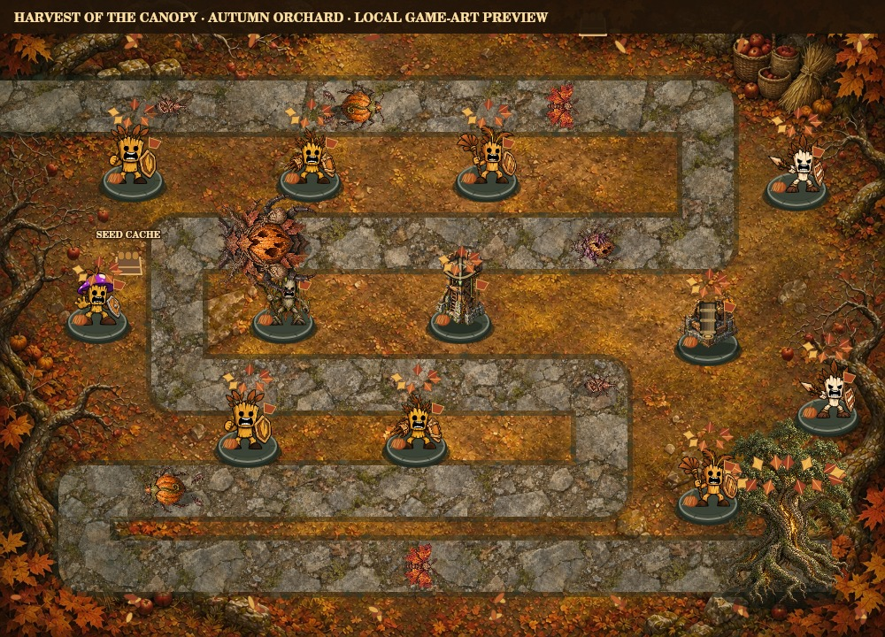

# Harvest of the Canopy

Fresh Harvest runs now use **eventVersion 2** and the dedicated `harvest-v2` autumn orchard route, with twelve repositioned build sites. An orange orchard ground painting, leaf-strewn stone lanes, harvest baskets, fall foliage uniforms on every defender and themed structural pennants make this a distinct battlefield. Invaders have their own seed-weevil, pumpkin beetle, maple moth, rot-gourd and Hollow Harvester artwork. The Tree of Life remains the health objective. No new token rewards or admission fee.

- **Seed thieves:** each surviving seed weevil steals up to 8 earned Sap once at the marked middle cache. Early coverage prevents the theft. Sap cannot become negative; TREE is unaffected.
- **Tailwinds:** ten calm battle seconds are followed by four seconds of 25% faster invader movement, repeating until the wave clears. Palm slows stack with the wind. The on-map rules banner shows the timer; pausing freezes it.
- **Hollow Harvester:** releases two extra seed thieves at 65% health and two at 30% health, once per threshold. Escorts enter at its route position. Save/reload and continues retain the threshold flags.

Existing version-one Harvest saves keep their original crossing route, queues and gameplay rules. They receive the new seasonal art/uniforms and a visible original-rules notice. Start a new Harvest run to play the orchard rules; the normal replacement confirmation protects unfinished battles. Campaign, Veteran and Haunted Grove rules are unchanged.

Unlock by protecting Emerald Crossing. Campaign roster and permanent growth carry over. New seasonal entry creates a fresh run using the existing confirmation/paid-run flow; it never resets permanent progress. Seasonal victories do not grant campaign stars, landmarks or roster unlocks.

| Wave | Seed thieves | Gourdback beetles | Maple-wing moths | Rot gourds | Harvester | Spawn gap |
|---|---:|---:|---:|---:|---:|---:|
| Seed watch | 7 | 2 | 0 | 0 | 0 | 1.15s |
| Bark armor | 6 | 5 | 0 | 0 | 0 | 1.25s |
| Autumn flight | 5 | 3 | 7 | 0 | 0 | 1.00s |
| Blighted harvest | 4 | 5 | 2 | 5 | 0 | 0.95s |
| Hollow Harvester | 5 | 7 | 4 | 4 | 1 | 0.85s |

The Hollow Harvester has 1,450 HP and the existing boss movement/breach rules. It has a new hollow-gourd stag-beetle silhouette and releases up to four extra seed thieves at its health thresholds; no new damage-resistance rule is added. Moth dashes, beetle defenses and blight regeneration retain existing behavior. Scouting shares the actual queue and presents matching counters, warnings and boss health labels.

| Earned reward | Goal |
|---|---|
| Harvest Defender badge | Clear all five waves |
| Copperleaf Oak | Complete at 80+ health |
| Harvest Watchtower banners | Win after planting three different defender types |
| Amber Tree of Life | Complete at 100 health |

Automatic fall uniforms apply to all defenders while playing Harvest. Earned reward looks remain cosmetic, optional, permanent, available at every NFTree rarity and usable in campaign play. Earned Sap plants defenders; TREE pays for optional growth, supplies and continues under the existing checkout rules. The deterministic milestone-roster test completes at 100 health with twelve Sapling defenders and zero TREE spent.

`harvest` progress and `harvestLooks` remain separate from Halloween `season`/`seasonLooks`. Legacy Haunted Grove mode/version, queued pests, timers, old reward IDs, active battles and appearances remain supported. Archived Halloween cosmetics are shown below the Harvest panel. Saves without Harvest fields default to zero progress; unsupported active event versions and mismatched map/version pairs are rejected. Battle reports retain all reward names. Gameplay saves remain editable browser data and never authorize token transfers.

Validation covers admission, queue/scout agreement, seasonal boss feedback, independent reward thresholds, no duplicate rewards, cosmetic-only application, Halloween save migration, Harvest reload/continue and zero-TREE completion. Actual mobile/device acceptance and a real TREE purchase remain manual checks.

This is a local render of the actual game art and seasonal layers, not a hosted gameplay screenshot.

## Previous version-one release status

Live at `https://tree-token.xyz/play/canopy-defense/checkout-test/`. Source `6c8fee69718ef03b704a90df7c13e192af8d537d` passes 172 local tests with one Windows-only skip, syntax checks and CI workflows `41332681774` / `41332677720`. Isolated backend deploy `6ae779a7606d80668ff269ff` is served through routing-only production release `6ae77a35cc69828cb3fe0ebd`.

Peter explicitly authorized canonical routing publication after automatic approval review requested production-impact approval. Post-publication checks confirm the same 41 function identities/configurations and five schedules as baseline `6ae76f2d9ef9b6c34dfba6e7`. Only `_redirects` changed; all other 283 static file hashes remain identical. No NFT/payment rules or production database changes were made.

The canonical page returns 200 and includes the Harvest card; anonymous access, payment and game-source requests remain 401. The November entry screen was visually inspected on the canonical domain. Hosted holder gameplay/mobile acceptance for this season remains to be performed by a player; the agent has not bypassed NFT gating or executed any live payment.

## Version-two orchard release

Live on checkout-test from `5b41029f87bbdb9e3b3d3efaabc9f6b613f7dc3b`. Backend `6aee76184855bbd05e6ff42f`; routing `6aee769eb270ae5a44d02d78`. 325 local tests passed, one Windows-only skip; syntax, protected build and both CI runs passed. The zero-TREE Sapling roster test clears all five waves at 100 health. The art fixture exercised all eight defense types and five invader roles, with unchanged alpha silhouettes and 131 unchanged neutral face pixels. Existing version-one saves retain geometry and rules; start a fresh Harvest run for the new orchard mechanics. Hosted protection, static assets and exact 43-function/five-schedule preservation checks passed. See [release receipt](../integration/tree-arcade/harvest-orchard-release-receipt.json). Holder desktop/phone acceptance remains pending.
