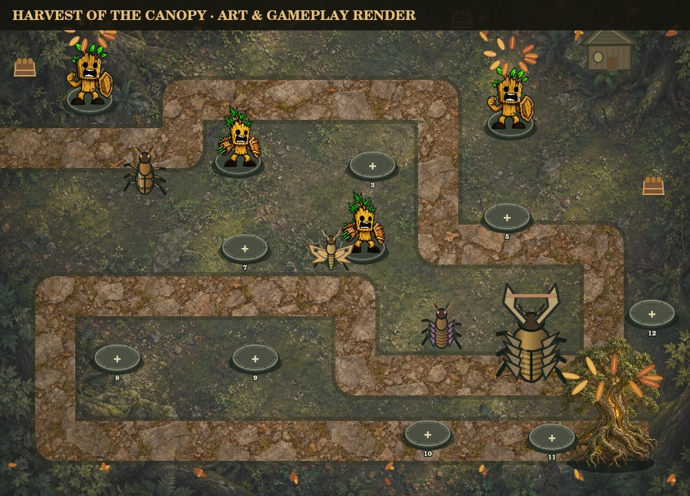

# Harvest of the Canopy

November's active seasonal challenge replaces the Halloween entry card. Protect the Tree of Life's seed reserves through five waves, using the original crossing route and twelve build sites. Seed-store ornaments are scenery; the existing Tree of Life health remains the defense objective. Copper leaves, warm terrain lighting and bronze pest colors provide the autumn theme. No new token rewards or admission fee.

Unlock by protecting Emerald Crossing. Campaign roster and permanent growth carry over. New seasonal entry creates a fresh run using the existing confirmation/paid-run flow; it never resets permanent progress. Seasonal victories do not grant campaign stars, landmarks or roster unlocks.

| Wave | Leaf borers | Bark beetles | Autumn moths | Harvest blight | Harvester | Spawn gap |
|---|---:|---:|---:|---:|---:|---:|
| Seed watch | 7 | 2 | 0 | 0 | 0 | 1.15s |
| Bark armor | 6 | 5 | 0 | 0 | 0 | 1.25s |
| Autumn flight | 5 | 3 | 7 | 0 | 0 | 1.00s |
| Blighted harvest | 4 | 5 | 2 | 5 | 0 | 0.95s |
| Hollow Harvester | 5 | 7 | 4 | 4 | 1 | 0.85s |

The Hollow Harvester has 1,450 HP and the existing boss movement/breach rules. It uses bronze insect armor artwork; no new damage-resistance rule is added. Moth dashes, beetle defenses and blight regeneration retain existing behavior. Scouting shares the actual queue and presents matching counters, warnings and boss health labels.

| Earned reward | Goal |
|---|---|
| Harvest Defender badge | Clear all five waves |
| Copperleaf Oak | Complete at 80+ health |
| Harvest Watchtower banners | Win after planting three different defender types |
| Amber Tree of Life | Complete at 100 health |

Rewards are cosmetic, optional, permanent, available at every NFTree rarity and usable in campaign play. Earned Sap plants defenders; TREE pays for optional growth, supplies and continues under the existing checkout rules. The deterministic milestone-roster test completes at 100 health with twelve Sapling defenders and zero TREE spent.

`harvest` progress and `harvestLooks` remain separate from Halloween `season`/`seasonLooks`. Legacy Haunted Grove mode/version, queued pests, timers, old reward IDs, active battles and appearances remain supported. Archived Halloween cosmetics are shown below the Harvest panel. Saves without Harvest fields default to zero progress; unsupported active event versions are rejected. Battle reports retain all reward names. Gameplay saves remain editable browser data and never authorize token transfers.

Validation covers admission, queue/scout agreement, seasonal boss feedback, independent reward thresholds, no duplicate rewards, cosmetic-only application, Halloween save migration, Harvest reload/continue and zero-TREE completion. Actual mobile/device acceptance and a real TREE purchase remain manual checks.

This is a local render of the actual game art and seasonal layers, not a hosted gameplay screenshot.

## Release status

Source `6c8fee69718ef03b704a90df7c13e192af8d537d` passes 172 local tests with one Windows-only skip, syntax checks, and CI workflows `41332681774` / `41332677720`. Isolated backend deploy `6ae779a7606d80668ff269ff` succeeded. Routing candidate `6ae77a35cc69828cb3fe0ebd` is ready but unpublished. Its 41 function identities/configurations and five schedules match baseline `6ae76f2d9ef9b6c34dfba6e7`; the only changed static file is `_redirects`.

Publication was blocked by automatic approval review because changing the canonical preview route affects the shared production site. The live site remains on the baseline. Explicit approval is needed for this routing-only production publication. No NFT/payment rule changes or production database mutations are included.
